<div align="center">

# 🧭 RevPilot

### GTM Data Pipeline & AI Lead Routing Engine

**Turns thousands of raw sign-ups into scored, researched, ready-to-contact leads, and puts them in front of the right sales rep in seconds.**


[🌐 Live website + interactive demo](#) · [🏗 Architecture](#-architecture) · [🧰 Tech stack](#-tech-stack-in-detail) · [🚀 Quick start](#-quick-start)

<!-- Add a GIF of the demo here:  -->

</div>

---

## 📑 Table of contents

1. [TL;DR](#-tldr-for-everyone)
2. [The problem](#-the-problem)
3. [Results](#-results)
4. [For recruiters](#-for-recruiters-what-this-project-demonstrates)
5. [Features](#-features)
6. [Architecture](#-architecture)
7. [Tech stack in detail](#-tech-stack-in-detail)
8. [How a lead flows through the system](#-how-a-lead-flows-through-the-system)
9. [The AI agent](#-the-ai-agent)
10. [Data model](#-data-model)
11. [Reliability design](#-reliability-design)
12. [Project structure](#-project-structure)
13. [Quick start](#-quick-start)
14. [Configuration](#-configuration)
15. [API reference](#-api-reference)
16. [Deployment on AWS](#-deployment-on-aws)
17. [CI/CD](#-cicd)
18. [Testing](#-testing)
19. [Security](#-security)
20. [Monitoring](#-monitoring-and-observability)
21. [Design decisions](#-design-decisions-and-trade-offs)
22. [Troubleshooting](#-troubleshooting)
23. [Roadmap](#-roadmap)
24. [Glossary](#-glossary-for-non-technical-readers)
25. [FAQ](#-faq)
26. [Contributing, license, author](#-contributing)

---

## 📌 TL;DR (for everyone)

Sales teams get flooded with leads: form fills, demo requests, trial sign-ups. Most are duplicates, half-empty, or not worth a call. Reps lose hours every day copying names into Google, LinkedIn and spreadsheets to work out *who to call first*.

**RevPilot does that work automatically.**

1. A lead arrives (a *webhook*, which is just an automatic message from a form or CRM).
2. RevPilot cleans it, removes duplicates, and fills in company details from outside sources.
3. An AI agent reads everything, looks for **buying signals**, and gives the lead a score from 0 to 100.
4. The best leads go to the right sales rep **in Slack**, with the reasons and a **personalised email already drafted**.

> Think of it as a very fast research assistant that never sleeps and never forgets to check anything.

## ❗ The problem

| Before RevPilot | After RevPilot |
|---|---|
| Leads sit in a queue until someone has time | Every lead is processed in seconds |
| The same person appears 3 times from 3 sources | One clean record per person |
| Reps spend ~20 min researching each lead | Research and a draft email are ready on arrival |
| One broken data source stops everything | Failures are retried, parked, and replayed, never lost |
| Gut feeling decides who to call | A transparent score with written reasons |

## 🏆 Results

| Metric | Outcome |
|---|---|
| Daily events ingested | **10,000+** webhook events |
| Leads scored by AI per day | **1,000+** |
| Manual lead-processing time | **↓ 85%** |
| Pipeline uptime | **99.9%** |
| AE (Account Executive) research time saved | **~20 minutes per lead** |
| Qualified pipeline | **↑ 30%** |

## 👀 For recruiters: what this project demonstrates

| Skill area | Evidence in this repo |
|---|---|
| **Backend engineering** | Async FastAPI service, typed Pydantic schemas, signature-verified and idempotent webhooks |
| **Data engineering** | Dedup, cleaning and enrichment in PostgreSQL using constraints, upserts and indexes; safe to re-run |
| **Reliability engineering** | Redis rate limiting, exponential-backoff retries, dead-letter queue with replay, health checks |
| **Applied AI / LLMs** | Multi-step LangGraph agent on the Claude API with structured outputs, guardrails and versioned prompts |
| **Product thinking** | Built around measurable outcomes: response speed, rep time saved, qualified pipeline |
| **Cloud and DevOps** | Docker, AWS EC2 / RDS / S3, automated tests and deploys with GitHub Actions |
| **Communication** | Clear docs, diagrams, and a non-technical live demo |

---

## ✨ Features

**Ingestion and data quality**
- High-volume webhook intake. Responds `202 Accepted` right away and processes in the background.
- HMAC signature verification on every webhook.
- Idempotent processing: re-delivered events never create duplicates.
- Cleaning: lower-cased emails, extracted domains, standardised job titles, normalised phone numbers, trimmed names.
- Fuzzy and exact deduplication (email, domain + name, phone).

**Enrichment**
- Company data from external REST APIs: size, industry, funding stage, location, tech stack, open roles.
- Redis token-bucket rate limiter per provider so quotas are never breached.
- Tenacity retries with exponential backoff and jitter for transient errors only.
- Dead-letter queue (DLQ) with full error context and a replay endpoint.

**AI and routing**
- LangGraph agent that profiles the account, detects buying signals, scores, and drafts outreach.
- Claude API with JSON-schema outputs, validated before anything is saved.
- Every score includes plain-English reasons.
- Routing by territory, segment, and current rep workload.
- Slack alert containing score, reasons, owner, and a ready-to-send email draft.

**Operations**
- Structured JSON logs, metrics endpoint, queue-depth and DLQ-size alarms.
- Raw payload archive in S3 so any run can be reproduced.
- Dockerised with one-command local setup.

---

## 🏗 Architecture

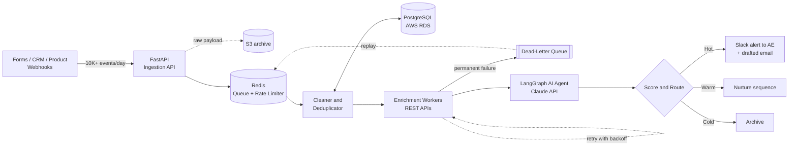

### Deployment view

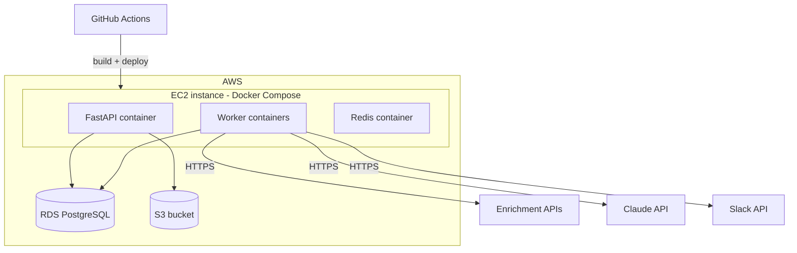

---

## 🧰 Tech stack in detail

### Core

| Technology | Role in RevPilot | Why this choice |
|---|---|---|
| **Python 3.11** | Primary language for API, workers and agent | Best ecosystem for data and AI; strong typing support |
| **FastAPI** | Webhook ingestion and REST API | Async I/O, automatic OpenAPI docs, tight Pydantic validation |
| **Pydantic v2** | Request/response and LLM output schemas | Fast validation; the same schemas guard AI output |
| **Uvicorn / Gunicorn** | ASGI server and process manager | Production-proven concurrency |

### Data layer

| Technology | Role | Why |
|---|---|---|
| **PostgreSQL 16** | System of record for leads, companies, events, scores | Unique constraints and `INSERT ... ON CONFLICT` make dedup safe under concurrency |
| **SQL** | Cleaning, merging, scoring queries, reporting views | Set-based logic is faster and clearer than row-by-row code |
| **SQLAlchemy 2 + asyncpg** | Async database access | Non-blocking queries under high event volume |
| **Alembic** | Schema migrations | Versioned, reviewable schema changes |
| **AWS S3** | Archive of raw webhook payloads | Cheap, durable, enables replay and audits |

### Pipeline and resilience

| Technology | Role | Why |
|---|---|---|
| **Webhooks** | Event intake from forms, CRM, product | Real-time, push-based |
| **REST APIs** | Company enrichment providers | Standard integration surface |
| **Redis 7** | Work queue, token-bucket rate limiter, short-lived dedup keys, DLQ list | Atomic operations and very low latency |
| **Tenacity** | Retry policy (exponential backoff + jitter, retry only on 429/5xx/timeouts) | Declarative, testable retry logic |
| **httpx** | Async HTTP client with timeouts | Connection pooling and clean async API |

### AI layer

| Technology | Role | Why |
|---|---|---|
| **Claude API (Anthropic)** | Buying-signal analysis, scoring rationale, outreach drafting | Strong reasoning and reliable structured output |
| **LangGraph** | Orchestrates the multi-step agent as a state graph | Explicit nodes and edges make decisions traceable, testable and replayable |
| **Prompt versioning** | Prompts stored as files with a version tag saved on every score | Lets you compare prompt versions and roll back |

### Integrations

| Technology | Role |
|---|---|
| **Slack API** | Posts hot-lead alerts with Block Kit formatting to the assigned rep or channel |

### Infrastructure and delivery

| Technology | Role |
|---|---|
| **Docker + Docker Compose** | Reproducible local and production environments |
| **AWS EC2** | Hosts API and worker containers |
| **AWS RDS (PostgreSQL)** | Managed database with backups and Multi-AZ option |
| **AWS S3** | Payload archive |
| **GitHub Actions** | Lint, test, build image, deploy on merge to `main` |

### Developer tooling

| Tool | Purpose |
|---|---|
| **pytest, pytest-asyncio** | Unit and integration tests |
| **respx** | Mock outbound HTTP calls |
| **Ruff** | Linting and formatting |
| **mypy** | Static type checks |
| **pre-commit** | Runs checks before every commit |

---

## 🔄 How a lead flows through the system

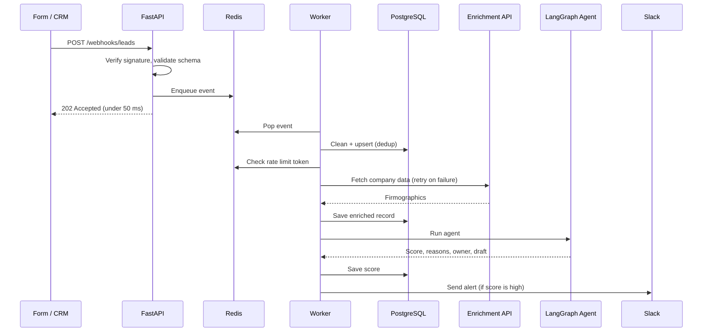

---

## 🧠 The AI agent

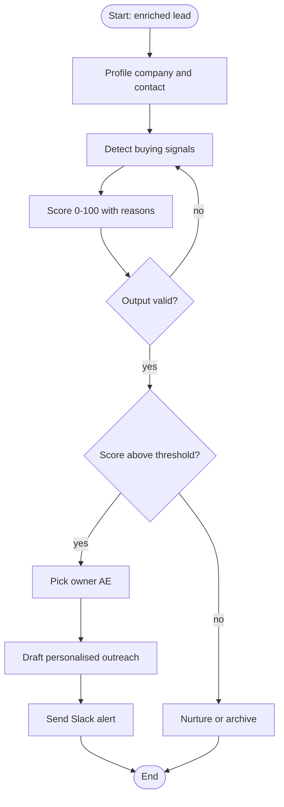

### Buying signals the agent looks for

| Signal | Example | Weight |
|---|---|---|
| High-intent action | Requested a demo, visited pricing 3+ times | High |
| Company growth | Hiring many sales roles, recent funding | High |
| Fit | Right company size, industry, tech stack | Medium |
| Buyer seniority | Director, VP, C-level | Medium |
| Competitor research | Comparing against other tools | Medium |
| Weak signals | Read one blog post | Low |

### Score tiers

| Score | Tier | Action |
|---|---|---|
| 75–100 | 🔥 Hot | Slack alert to AE with outreach draft |
| 50–74 | 🌤 Warm | Added to nurture sequence, AE notified in digest |
| 0–49 | ❄ Cold | Archived and re-scored if new activity appears |

### Example structured output

```json
{
  "score": 92,
  "tier": "hot",
  "signals": [
    {"type": "intent", "detail": "Visited pricing page 3 times", "impact": "+25"},
    {"type": "growth", "detail": "Hiring 6 sales reps", "impact": "+20"},
    {"type": "fit", "detail": "420 employees, logistics", "impact": "+15"}
  ],
  "summary": "Fast-growing logistics company actively evaluating tools.",
  "recommended_owner": "maya.chen",
  "prompt_version": "scoring_v3"
}
```

### Example Slack alert

```
🔥 Hot lead · Northwind Logistics · Score 92
Priya Shah, VP Sales · assigned to @Maya

Why now:
• Visited pricing page 3 times this week
• Hiring 6 sales reps (rapid growth)
• 420 employees, strong fit

✉️ Draft email is ready: [View] [Copy] [Mark contacted]
```

### Guardrails

- LLM output must pass Pydantic validation; invalid output triggers a bounded retry.
- The agent only sees data fields it needs (no unnecessary personal data).
- Scores and prompt versions are stored for every decision, so results are auditable.
- Outreach is a **draft**: a human always sends it.

---

## 🗄 Data model

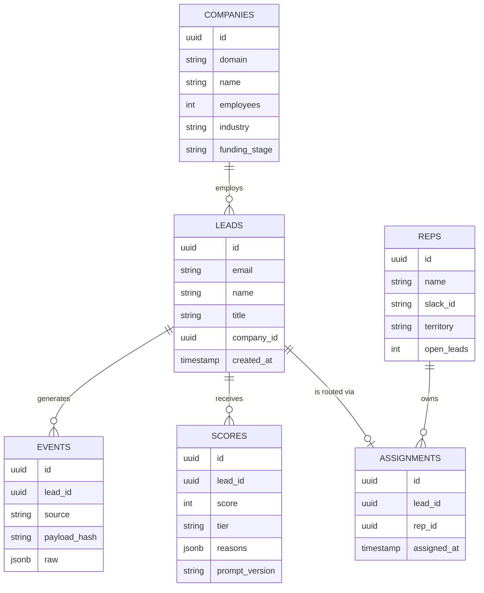

### Key SQL patterns

```sql
-- Idempotent ingestion: same payload never inserts twice
INSERT INTO events (lead_id, source, payload_hash, raw)
VALUES (:lead_id, :source, :hash, :raw)
ON CONFLICT (payload_hash) DO NOTHING;

-- Dedup + merge: one lead per normalised email
INSERT INTO leads (email, name, title, company_id)
VALUES (lower(trim(:email)), :name, :title, :company_id)
ON CONFLICT (email) DO UPDATE
SET name  = COALESCE(EXCLUDED.name, leads.name),
    title = COALESCE(EXCLUDED.title, leads.title),
    updated_at = now();

-- Helpful indexes
CREATE UNIQUE INDEX ux_leads_email ON leads (email);
CREATE UNIQUE INDEX ux_events_hash ON events (payload_hash);
CREATE INDEX ix_scores_lead_created ON scores (lead_id, created_at DESC);
```

---

## 🛡 Reliability design

| Failure | What RevPilot does |
|---|---|
| Webhook sent twice | Payload hash makes the second one a no-op |
| Enrichment API returns `429` | Rate limiter slows down; Tenacity retries with backoff |
| Enrichment API is down | Retries, then event moves to the DLQ with its error |
| Claude API times out | Bounded retries; the lead stays queued, never dropped |
| Invalid AI output | Validation fails, node retries, then flags for review |
| Worker crashes mid-job | Job is re-queued (visibility timeout), safe due to idempotency |
| Slack is unavailable | Alert is retried; score is already saved |

```python
from tenacity import retry, stop_after_attempt, wait_exponential_jitter, retry_if_exception_type

@retry(
    retry=retry_if_exception_type((TimeoutError, TransientAPIError)),
    wait=wait_exponential_jitter(initial=1, max=30),
    stop=stop_after_attempt(5),
    reraise=True,
)
async def fetch_company(domain: str) -> dict:
    await rate_limiter.acquire("enrichment")   # Redis token bucket
    return await client.get(f"/companies/{domain}")
```

---

## 📂 Project structure

```
revpilot/
├── app/
│   ├── main.py                 # FastAPI entrypoint
│   ├── api/
│   │   ├── webhooks.py         # POST /webhooks/leads
│   │   ├── leads.py            # GET /leads/{id}
│   │   ├── dlq.py              # replay endpoint
│   │   └── health.py
│   ├── core/                   # config, logging, db, redis
│   ├── pipeline/
│   │   ├── ingest.py           # validate, hash, enqueue
│   │   ├── clean.py            # normalisation
│   │   ├── dedupe.py           # matching and merge
│   │   ├── enrich.py           # REST enrichment + retries
│   │   ├── ratelimit.py        # Redis token bucket
│   │   └── dlq.py              # dead-letter handling
│   ├── agent/
│   │   ├── graph.py            # LangGraph definition
│   │   ├── nodes.py            # profile, signals, score, draft
│   │   ├── schemas.py          # Pydantic output models
│   │   └── prompts/            # versioned prompt files
│   ├── routing/                # territory + capacity rules
│   ├── integrations/slack.py
│   └── workers/run.py          # worker entrypoint
├── migrations/                 # Alembic
├── tests/
│   ├── unit/
│   └── integration/
├── docs/                       # diagrams, demo GIF
├── docker-compose.yml
├── Dockerfile
├── .env.example
├── pyproject.toml
└── .github/workflows/ci.yml
```

---

## 🚀 Quick start

**Prerequisites:** Docker, Docker Compose, an Anthropic API key, a Slack bot token.

```bash
git clone https://github.com/<your-username>/revpilot.git
cd revpilot
cp .env.example .env          # fill in your keys
docker compose up --build
docker compose exec api alembic upgrade head
```

Open the interactive docs at **http://localhost:8000/docs**.

### Send a test lead

```bash
curl -X POST http://localhost:8000/webhooks/leads \
  -H "Content-Type: application/json" \
  -H "X-Signature: <hmac-sha256-of-body>" \
  -d '{
    "email": "priya@northwind.io",
    "name": "Priya Shah",
    "title": "VP Sales",
    "company_domain": "northwind.io",
    "source": "demo_request"
  }'
```

You should receive `202 Accepted`, and a Slack alert shortly after if the lead scores above the threshold.

### Run without Docker

```bash
python -m venv .venv && source .venv/bin/activate
pip install -e ".[dev]"
uvicorn app.main:app --reload
python -m app.workers.run
```

### docker-compose.yml (summary)

```yaml
services:
  api:
    build: .
    command: uvicorn app.main:app --host 0.0.0.0 --port 8000
    env_file: .env
    ports: ["8000:8000"]
    depends_on: [db, redis]
  worker:
    build: .
    command: python -m app.workers.run
    env_file: .env
    deploy: { replicas: 3 }
    depends_on: [db, redis]
  db:
    image: postgres:16
    environment: { POSTGRES_PASSWORD: postgres, POSTGRES_DB: revpilot }
    volumes: ["pgdata:/var/lib/postgresql/data"]
  redis:
    image: redis:7
volumes:
  pgdata:
```

---

## ⚙ Configuration

| Variable | Description | Example |
|---|---|---|
| `DATABASE_URL` | PostgreSQL connection string | `postgresql+asyncpg://user:pass@db:5432/revpilot` |
| `REDIS_URL` | Redis connection string | `redis://redis:6379/0` |
| `ANTHROPIC_API_KEY` | Claude API key | `sk-ant-...` |
| `CLAUDE_MODEL` | Model used by the agent | set to your chosen model |
| `ENRICHMENT_API_KEY` | Company data provider key | `...` |
| `ENRICHMENT_RPS` | Max requests per second to the provider | `5` |
| `SLACK_BOT_TOKEN` | Slack bot token | `xoxb-...` |
| `SLACK_CHANNEL_ID` | Channel for hot-lead alerts | `C0123456` |
| `WEBHOOK_SECRET` | Shared secret for HMAC verification | `change-me` |
| `HOT_LEAD_THRESHOLD` | Score that triggers routing | `75` |
| `MAX_RETRIES` | Retry attempts before DLQ | `5` |
| `S3_BUCKET` | Raw payload archive bucket | `revpilot-raw` |
| `LOG_LEVEL` | Logging level | `INFO` |

---

## 🔌 API reference

| Method | Endpoint | Description |
|---|---|---|
| `POST` | `/webhooks/leads` | Ingest a lead event (returns `202`) |
| `GET` | `/leads/{id}` | Lead details, latest score, reasons |
| `GET` | `/leads?tier=hot&limit=50` | List leads by tier |
| `GET` | `/health` | Liveness check |
| `GET` | `/ready` | Readiness (DB and Redis reachable) |
| `GET` | `/metrics` | Queue depth, DLQ size, processing latency |
| `GET` | `/dlq` | List failed events |
| `POST` | `/dlq/replay` | Re-queue failed events |

---

## ☁ Deployment on AWS

1. **RDS:** create a PostgreSQL 16 instance in a private subnet; enable automated backups.
2. **S3:** create a private bucket for raw payloads with a lifecycle rule (for example, archive after 90 days).
3. **EC2:** launch an instance, install Docker, attach an IAM role with S3 access (no hard-coded keys).
4. **Secrets:** keep API keys in AWS Systems Manager Parameter Store or Secrets Manager.
5. **Network:** security group allows 443 inbound to the API only; RDS accepts connections only from the EC2 security group.
6. **Deploy:** GitHub Actions builds the image and runs `docker compose up -d` on the instance.
7. **TLS:** terminate HTTPS with Nginx or an Application Load Balancer.

---

## 🔁 CI/CD

```yaml
# .github/workflows/ci.yml
name: CI
on: [push, pull_request]
jobs:
  test:
    runs-on: ubuntu-latest
    services:
      postgres: { image: "postgres:16", env: { POSTGRES_PASSWORD: postgres }, ports: ["5432:5432"] }
      redis:    { image: "redis:7", ports: ["6379:6379"] }
    steps:
      - uses: actions/checkout@v4
      - uses: actions/setup-python@v5
        with: { python-version: "3.11" }
      - run: pip install -e ".[dev]"
      - run: ruff check .
      - run: mypy app
      - run: pytest -q --cov=app
  deploy:
    needs: test
    if: github.ref == 'refs/heads/main'
    runs-on: ubuntu-latest
    steps:
      - uses: actions/checkout@v4
      - run: echo "Build image, push, SSH to EC2 and restart containers"
```

---

## 🧪 Testing

```bash
pytest -q                 # all tests
pytest tests/unit         # fast tests
ruff check . && mypy app  # lint and types
```

| Test type | What it covers |
|---|---|
| Unit | Cleaning rules, dedup matching, scoring tiers, routing logic |
| Integration | Webhook to database to queue using real Postgres and Redis |
| Resilience | Simulated `429`, timeouts, and crashes; verifies retries and DLQ |
| Agent | Mocked Claude responses; verifies graph paths and schema validation |

---

## 🔐 Security

- HMAC-SHA256 signature check on all webhooks.
- Secrets only from environment or AWS secret stores; never committed.
- Least-privilege IAM role for S3.
- Database is private; only the application can reach it.
- Personal data minimised before sending to the LLM.
- Rate limiting on public endpoints.
- Dependencies scanned with Dependabot.

---

## 📈 Monitoring and observability

| Signal | How |
|---|---|
| Structured logs | JSON logs with `event_id` and `lead_id` on every line for tracing |
| Queue depth | `/metrics`; alert if it keeps growing |
| DLQ size | Alert if above zero for too long |
| Latency | Time from webhook receipt to Slack alert |
| Uptime | External health check on `/health` (target 99.9%) |
| Cost | Tracks LLM tokens and enrichment calls per lead |

---

## 🧭 Design decisions and trade-offs

| Decision | Reason | Trade-off |
|---|---|---|
| Acknowledge webhooks, process async | Providers time out quickly and retry; fast ack avoids duplicate storms | Needs a queue and workers |
| Redis for queue and limiter | Atomic operations, simple to run | Needs persistence settings to avoid job loss on restart |
| Postgres constraints for dedup | Database is the single source of truth under concurrency | Schema changes need migrations |
| LangGraph over a single prompt | Separate nodes are testable and traceable | More code than one call |
| AI drafts, humans send | Protects brand and trust | One extra click for the rep |
| Docker Compose on EC2 | Simple and cheap at this scale | Move to ECS/Kubernetes when scaling out |

---

## 🛠 Troubleshooting

| Symptom | Likely cause | Fix |
|---|---|---|
| `401 Invalid signature` | Wrong `WEBHOOK_SECRET` or body altered | Sign the exact raw body |
| Leads stuck in queue | Workers not running | `docker compose ps`, check worker logs |
| Many events in DLQ | Enrichment provider outage or bad key | Check key, then `POST /dlq/replay` |
| No Slack alerts | Bot not in channel or score below threshold | Invite the bot; check `HOT_LEAD_THRESHOLD` |
| Duplicate leads | Emails not normalised | Confirm the `ux_leads_email` index exists |

---

## 🗺 Roadmap

- [ ] CRM write-back (HubSpot / Salesforce)
- [ ] Feedback loop: learn from won and lost deals
- [ ] A/B testing of outreach drafts
- [ ] Admin dashboard for scoring rules and rep capacity
- [ ] Move queue to AWS SQS for managed durability
- [ ] Multi-language outreach drafts

---

## 📖 Glossary (for non-technical readers)

| Term | Plain meaning |
|---|---|
| **Lead** | A person or company that might buy |
| **Webhook** | An automatic message one app sends another when something happens |
| **Deduplication** | Merging repeated records of the same person |
| **Enrichment** | Adding missing facts, such as company size, from outside sources |
| **Buying signal** | A behaviour that suggests someone is ready to buy |
| **AE** | Account Executive, the salesperson who closes deals |
| **Rate limit** | A cap on how many requests a service allows per second |
| **Retry** | Trying again after a temporary failure |
| **Dead-letter queue** | A safe holding area for jobs that kept failing, so nothing is lost |
| **LLM** | Large language model, the AI behind Claude |
| **Agent** | An AI program that works through several steps to reach a goal |

## ❓ FAQ

**Does the AI send emails by itself?** No. It writes a draft; the sales rep reviews and sends it.

**What happens if a data provider goes down?** The pipeline retries, then parks the event in the dead-letter queue. When the provider returns, one call replays everything.

**Can the scoring rules be changed?** Yes. Weights and thresholds are configuration, and prompts are versioned.

**How is personal data handled?** Only the fields needed for scoring are shared with the AI, and secrets never live in the code.

---

## 🤝 Contributing

1. Fork the repo and create a branch: `git checkout -b feature/my-change`
2. Run `pre-commit install`
3. Add tests and make sure `pytest` passes
4. Open a pull request describing the change

## 📄 License

Released under the MIT License.

## 👤 Author

**Your Name**: [LinkedIn](#) · [Portfolio](#) · [Email](#)

<div align="center">

⭐ If this project helped you, please star the repo.

</div>

  [](LICENSE)
  [](https://github.com/asiifdev/business-leads-ai-automation/stargazers)
  [](https://www.typescriptlang.org/)
  [](https://nextjs.org/)
  [](https://nestjs.com/)
  [](https://www.postgresql.org/)
</div>

<p align="center">
  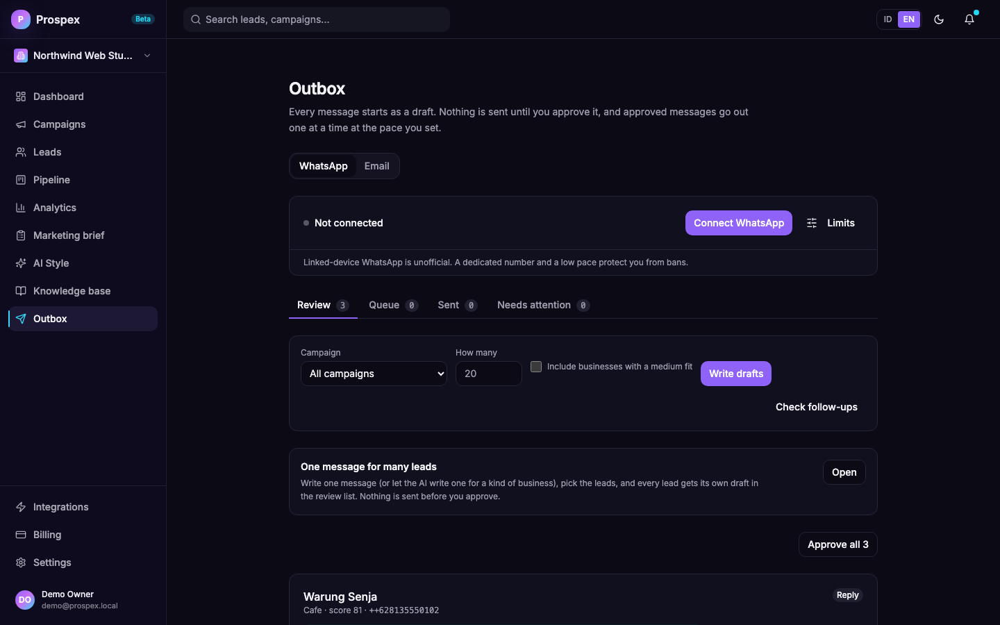
</p>

## Why Prospex exists

Selling to local businesses means hundreds of first messages and just as many follow-ups. Most tools either hide the work behind a bulk sender that gets numbers banned, or leave you to write everything yourself.

Prospex splits the job in two. The AI does the typing: it finds the leads, writes each draft, and drafts the replies and follow-ups. You do the deciding: every message waits in your Outbox until you approve it, and approved messages leave at a pace you set, one at a time.

> **Prefer not to run servers?** The hosted version at **[alatpintar.id](https://alatpintar.id)** runs Prospex for you. Self-hosting is free under the AGPL.

If Prospex is useful to you, a star helps other people find it.

## What you can do with it

| Step | What happens |
|------|--------------|
| **Understand your offer** | Give Prospex a website, a document (PDF, DOCX, Markdown, text) or pasted text. It reads the whole site (sitemap, `llms.txt`, linked pages), writes a Marketing Brief from what it finds, and fills in your campaign form for you to correct. What the sources do not say is listed as missing, not invented. |
| **Find** | Scrape Google Maps by business type and city with a headless browser, up to 2,000 leads per campaign. A typed city is searched where you asked (anchored on its coordinates, results outside about 50 km are dropped); "Seluruh Indonesia" becomes one search per city, biggest markets first, 40 or more results per search. Each lead carries the real Maps category, rating, review count, phone, website and coordinates. If scraping fails the campaign fails honestly: Prospex never makes up businesses. A campaign can also look in **Overture Maps** (open place data with phone numbers for many businesses that only have a Facebook page), in **OpenStreetMap** (free; finds businesses that are not on Google Maps, only those with a phone, website or email; no ratings; coverage depends on the area) and you can **import a CSV or Excel file** you already have. Sources are tried in order, the same business found twice becomes one lead, and nothing paid is needed apart from your AI provider. |
| **Score** | A 0 to 100 ranking from signals in the listing (reachable by phone, rating weighted by review count, review volume) plus an AI judgement of how well the business fits your offer, with the reason shown. No hard-coded industry or city weights. |
| **Draft** | The AI writes the first message from the lead's real data, your own style, the matching angle from your brief and your knowledge base. WhatsApp messages say who you are and what you offer in the first sentence, in plain words, then one relevant point and one easy question. Emails open with a greeting, end with "Salam," and can carry one link you set yourself. Three openings rotate across a campaign so you can compare reply rates. |
| **One message for many leads** | Prefer to write it once? In the Outbox, pick a kind of business (for example every kebaya rental), choose the leads, write the message or let the AI write one for that kind of business, and Prospex makes one draft per lead in the review list. `{nama}` and `{kategori}` fill in each lead's own name and category. No AI call per lead, so hundreds of drafts take a second. |
| **Approve** | Read, edit, approve or reject each draft in the Outbox, shown as the WhatsApp bubble it will be (bold, italics, lists, the link card, the attached file). Attach a file or a link preview if you want one. Nothing is sent before this step. |
| **Organise** | Every lead is reachable: paged lists, search by name, address, phone, website, email, category or area, province, city and district worked out from the coordinates, and a map that shows all leads. |
| **Send** | Approved messages go out through WhatsApp one at a time: hourly and daily caps, quiet hours, random gaps, and a typing indicator before each one. Email works the same way through your own SMTP account, with an unsubscribe link in every message, and refuses to send at all while that link would point to your own computer ([docs/email-channel.md](docs/email-channel.md)). |
| **Track to closing** | The Pipeline page shows every stage with deal value, replies waiting for you, leads that went quiet, follow-ups due, results per campaign and why deals were lost. A deal is never closed automatically; you mark it won or lost. |
| **Reply and follow up** | A reply is read against the whole conversation, including what you typed on your own phone. It is classified (interested, wants a meeting, asked the price, question, pointed to another contact, not now, not interested), moves the lead forward in the pipeline, cancels pending follow-ups, flags it as waiting for you, and creates a polite reply draft written as a seller approaching a business, not as a boss. A shop's automatic greeting is recognised and ignored. An approved reply goes out right away, ahead of the cold messages. Leads that stay silent get up to two follow-up drafts, after 3 and 5 days. A recipient who writes STOP is never contacted again and the lead is closed as lost. |

Every feature, its purpose, its limits and how far it has been verified: [docs/features.md](docs/features.md), [editions](docs/editions.md).

### Screenshots

<table>
  <tr>
    <td width="50%">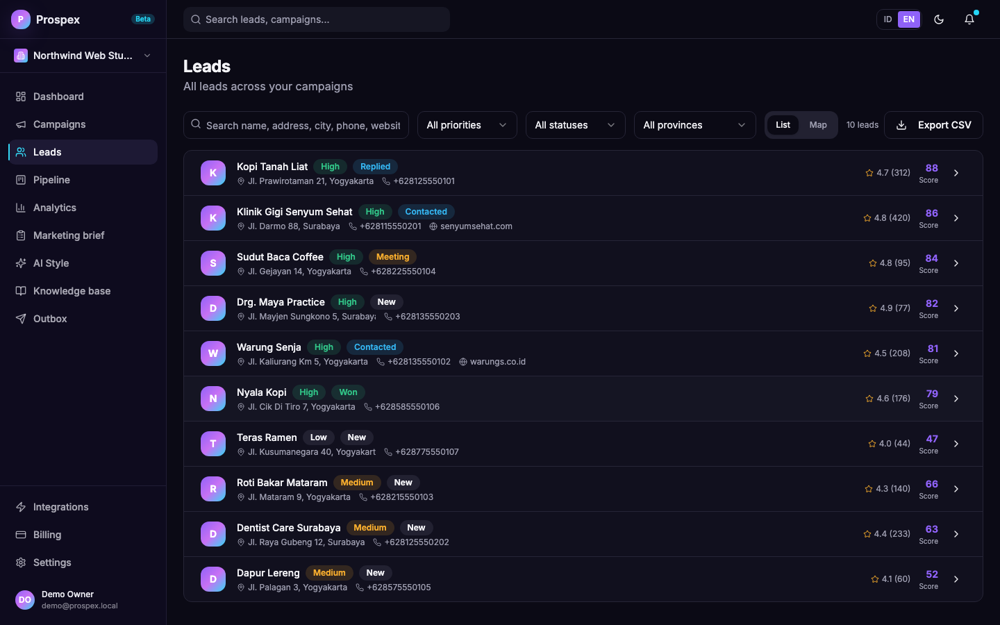<br><sub><b>Leads.</b> Scored, filterable by priority, status, province, city and district. List and map views.</sub></td>
    <td width="50%">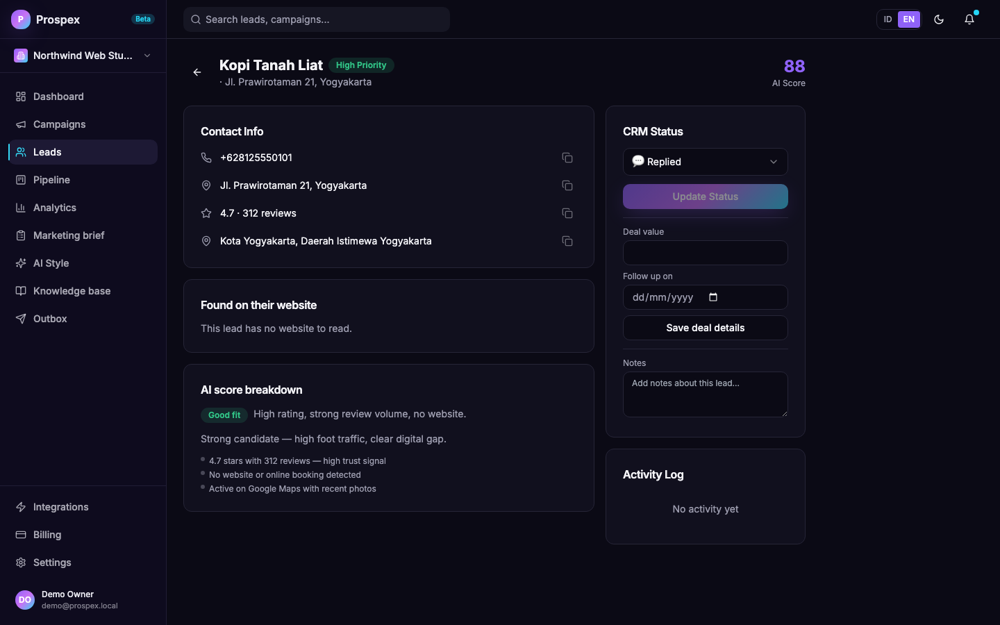<br><sub><b>Lead detail.</b> Contact info, AI score breakdown (fit badge, reason and factors), email and call notes, and CRM notes — all in one page.</sub></td>
  </tr>
  <tr>
    <td width="50%"><br><sub><b>Outbox.</b> Every message waits for your approval. WhatsApp and Email tabs, Review / Queue / Sent / Needs attention.</sub></td>
    <td width="50%">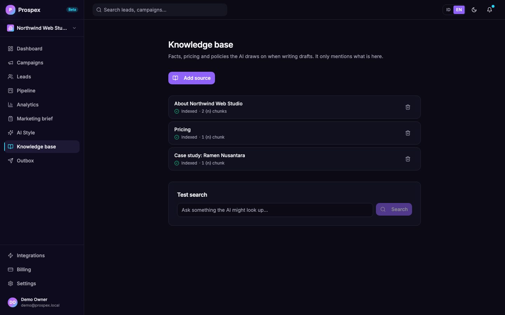<br><sub><b>Knowledge base.</b> Facts, pricing and case studies the AI may draw on when writing drafts. Add any text; the AI only mentions what is here.</sub></td>
  </tr>
  <tr>
    <td width="50%">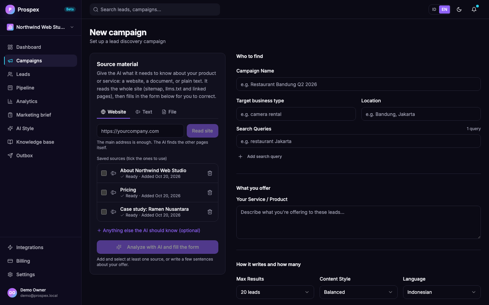<br><sub><b>Campaigns.</b> Give it a website or documents; the AI fills the brief and says what it could not find.</sub></td>
    <td width="50%">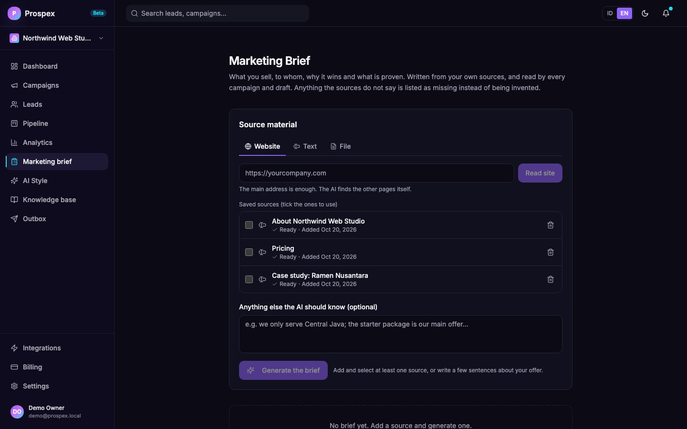<br><sub><b>Marketing brief.</b> What you sell, to whom, what is proven, and what is still missing. Every section is editable.</sub></td>
  </tr>
  <tr>
    <td width="50%">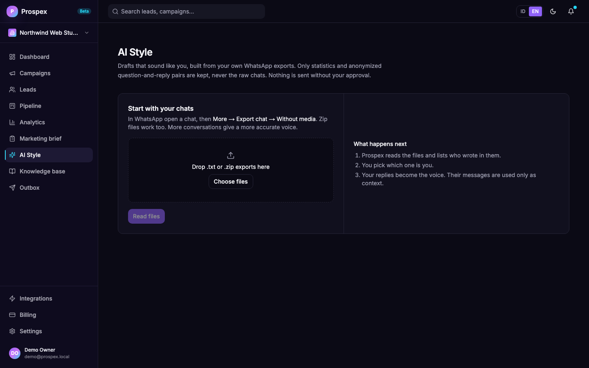<br><sub><b>AI Style.</b> Voice learned from your own WhatsApp exports: reply length, emoji, punctuation, openers.</sub></td>
    <td width="50%">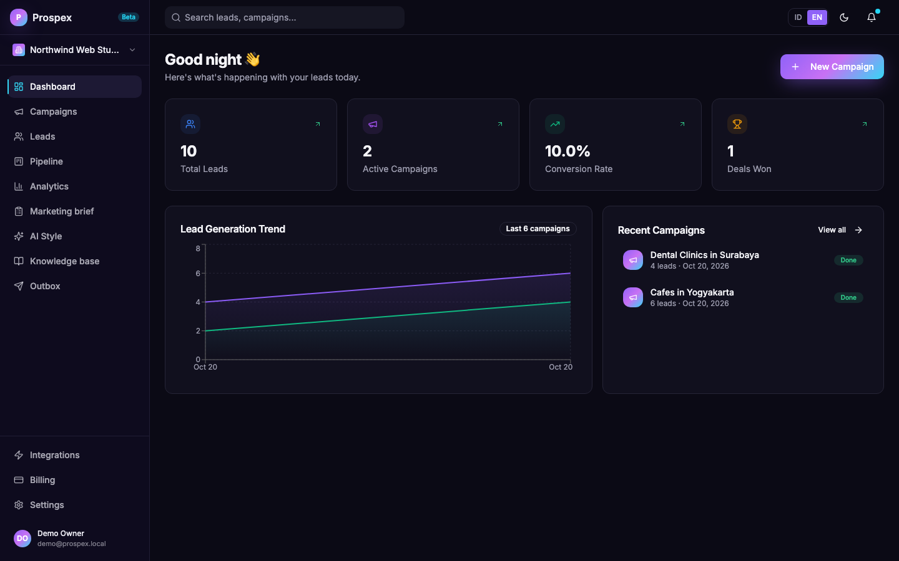<br><sub><b>Dashboard.</b> Leads, campaigns, conversion rate and deals won at a glance.</sub></td>
  </tr>
</table>

<sub>The data in these screenshots is fictional demo data (a made-up studio, made-up clients).</sub>

## Understanding your offer

Most outreach tools ask you to type a one-line description and hope. Prospex asks for the real material instead, then shows its work:

- **Sources**: a website (the main address is enough), pasted text, or files (`.pdf`, `.docx`, `.md`, `.txt`).
- **Whole-site reading**: besides the page you give, it follows `llms.txt`, the sitemap and the home page's links, up to 40 pages, and opens JavaScript-only pages in a real browser.
- **A brief with evidence rules**: numbers, customer names, testimonials and prices must appear in your sources or they are dropped and listed as missing.
- **You stay in charge**: the brief and the campaign form are editable, fields filled by the AI are marked, and anything you typed yourself is never overwritten.
- **Write once, reuse**: the analysis runs in the background (a small local model needs minutes; the page shows the step and you may leave it). A new campaign can then be filled instantly from the saved brief, with no new AI run. Analyse again only when your sources change.

[How it works, limits, and tips for local models](docs/marketing-brief.md).

## Writing in your own voice

AI Style is optional. If you use it, you export a few of your own WhatsApp chats (WhatsApp's official **Export chat** feature, `.txt` or `.zip`) and pick which participant is you. Prospex then:

- measures how you write: reply length, emoji, punctuation, how you open and close;
- stores anonymized pairs of *what the customer wrote* and *how you answered*, so it can show the model your real replies to similar questions;
- never stores the raw chats. Phone numbers, emails and links are replaced before anything is saved.

It is retrieval, not model training, so you can delete the profile at any time and nothing remains in a model. Everything can run on your machine with Ollama. [How it works, what it costs and how well it did in testing](docs/ai-style.md).

## Sending that protects your number

WhatsApp bans numbers that behave like bulk senders. Prospex is built around not behaving like one:

| Safeguard | Default |
|-----------|---------|
| Human approval before every message | Always on |
| Messages per hour | 10 (configurable 1 to 30) |
| Messages per day | 80 (configurable 1 to 200) |
| Quiet hours | 21:00 to 07:00 in your timezone |
| Gap between messages | Random, 0.6x to 1.4x of the hourly average |
| Typing indicator | Shown before each message, scaled to its length |
| Number check | Skips numbers that are not on WhatsApp, without counting them as failures |
| STOP handling | Cancels pending messages and blocks the number permanently |
| Opt-out line | Added to every first message and follow-up |
| Messages you type on your own phone | Recorded only for numbers that belong to a lead: the lead stops waiting for an answer and outdated drafts are withdrawn. They do not count toward the limits. |
| Replies to people who wrote to you | Not paced: an approved reply is sent on the next tick, ahead of the cold queue, and does not count toward the limits |
| Automatic greetings from shops | Recognised and ignored: no stage change, no reply draft |
| Circuit breaker | Pauses sending after 3 failures in a row |
| Crash safety | A message interrupted mid-send is marked failed, never resent automatically |

Pace decides the calendar. At the defaults (10 per hour, 80 per day) a list of 1,500 leads takes about 19 days. Raising the daily cap to 140, the most that 10 per hour allows between 07:00 and 21:00, shortens it to about 11 days. Start with a batch of 30 to 50 leads, watch the reply rate and the account, then scale up. Details and the reasoning are in [docs/whatsapp-outbox.md](docs/whatsapp-outbox.md).

**Two ways to connect WhatsApp.** Today Prospex connects as a linked device (Baileys), which works with any number but is unofficial, so use a dedicated business number. The official WhatsApp Business Cloud API is planned as a hosted-only feature (alatpintar.id subscribers), delivered as a separate private connector that is not built yet. The sender already talks to WhatsApp through one provider interface, and the Outbox settings show the option locked outside the hosted edition. See [docs/editions.md](docs/editions.md).

## Tech stack

| Layer | Technology |
|-------|-----------|
| **Frontend** | Next.js 16 (App Router), shadcn/ui, Tailwind CSS, Recharts, English and Indonesian interface |
| **Backend** | NestJS 10, Prisma ORM, REST API with Swagger |
| **Database** | PostgreSQL 16 with pgvector |
| **Queue** | BullMQ and Redis 7 for scraping jobs |
| **AI** | Any OpenAI-compatible provider: OpenAI, OpenRouter, Ollama |
| **Scraping and site reading** | Playwright with headless Chromium, behind a proxy that refuses private addresses |
| **Documents** | `unpdf` for PDF (in a worker thread), `fflate` for DOCX |
| **WhatsApp** | Baileys (linked device) |
| **Area lookup** | OpenStreetMap Nominatim (optional, point it at your own instance or turn it off) |
| **Monorepo** | Turborepo and pnpm workspaces |

<a id="quickstart"></a>
## Quickstart

You need [Node.js 20+](https://nodejs.org/), [pnpm 9+](https://pnpm.io/) and [Docker](https://www.docker.com/).

```bash
git clone https://github.com/asiifdev/business-leads-ai-automation.git
cd business-leads-ai-automation
pnpm install

cp .env.example apps/api/.env
cp .env.example packages/database/.env
# edit apps/api/.env: DATABASE_URL, JWT_SECRET, ENCRYPTION_KEY, OPENAI_*

docker compose up -d                       # PostgreSQL 16 with pgvector, and Redis
pnpm --filter @prospex/database db:deploy  # apply migrations
pnpm --filter @prospex/database exec prisma generate
pnpm --filter @prospex/api exec playwright install chromium   # the browser that scrapes Google Maps and reads websites

pnpm --filter @prospex/api dev             # API on :3001
pnpm --filter @prospex/web dev             # dashboard on :3000
pnpm start                                  # production: turbo builds, then runs API (:3001), web (:3000) and marketing (:3002)
```

Open [http://localhost:3000](http://localhost:3000), register, and create your first campaign. Swagger lives at [http://localhost:3001/api/docs](http://localhost:3001/api/docs).

Your first outreach, step by step:

1. **Campaigns, New campaign**: add your website or documents under *Source material* and press **Analyze with AI**. Check the filled form, then start the campaign. (You can also fill the form by hand.)
2. **AI Style** (optional): import a few of your WhatsApp chat exports.
3. **Outbox**: click **Connect WhatsApp** and scan the code with the phone (WhatsApp, Linked devices). Use a dedicated number.
4. **Outbox, Review**: choose the campaign, click **Write drafts**, then approve what you like.

The full walkthrough is in [docs/USER_GUIDE_EN.md](docs/USER_GUIDE_EN.md) (English) and [docs/USER_GUIDE.md](docs/USER_GUIDE.md) (Indonesian).

### Choosing an AI provider

Any OpenAI-compatible endpoint works. Drafts need a chat model, and the style and knowledge features need an embedding model (`EMBEDDING_MODEL`). Switching the embedding model later means re-importing your chats and re-indexing your sources, because vectors from different models cannot be compared.

```env
# OpenAI
OPENAI_API_KEY=sk-...
OPENAI_MODEL=gpt-4o-mini
EMBEDDING_MODEL=text-embedding-3-small

# OpenRouter
OPENAI_API_KEY=sk-or-...
OPENAI_BASE_URL=https://openrouter.ai/api/v1
OPENAI_MODEL=anthropic/claude-haiku-4-5

# Ollama, fully local
OPENAI_API_KEY=ollama
OPENAI_BASE_URL=http://localhost:11434/v1
OPENAI_MODEL=gemma4
EMBEDDING_MODEL=qwen3-embedding
```

With `OPENAI_API_KEY` empty, scraping and rule-based scoring still work, and the AI features (drafts, AI Style, knowledge base) are off. Prospex does not fill the gap with canned text. A local model can take around 40 seconds per draft, so drafting runs in the background and the Outbox shows progress. Writing the Marketing Brief with a local model takes several minutes. For Ollama, a context length of 16,384 is enough (our biggest prompt is about 7,000 tokens) and uses far less memory than the 131,072 some installs default to; if it is sometimes slow or answers with a 500 error, check that nothing else is using the model at the same time, because Ollama serves one request at a time by default.

### Other settings

| Variable | Default | Purpose |
|----------|---------|---------|
| `OPENAI_REASONING_EFFORT` | empty | Set to `none` for reasoning models such as Ollama `gemma4` or `qwen3`: it switches off the thinking phase and is about ten times faster for these tasks. Leave empty for models that do not support it (for example `gpt-4o-mini`). |
| `BRIEF_SOURCE_CHARS` | `30000` | How much source text each pass of the Marketing Brief reads. Lower it if your model has a small context window. |
| `SCRAPER_MODE` | `live` | `fixture` returns clearly labelled test leads without phone numbers. For tests and demos only. |
| `PLAYWRIGHT_NO_SANDBOX` | unset | Set to `true` only where Chromium cannot create its sandbox (most containers; the Docker image sets it). Outside containers keep the sandbox on: the browser opens pages chosen by users. |
| `WA_AUTH_DIR` | `./.wa-auth` | Where linked-device sessions are stored. Mount it as a volume in production and treat it like a password. |
| `ATTACHMENTS_DIR` | `./.attachments` | Where files uploaded to send on WhatsApp are kept (one folder per workspace). Mount it as a volume in production. |
| `GEOCODER_URL` | `https://nominatim.openstreetmap.org` | Reverse-geocoding service used to work out each lead's province, city and district from its coordinates. The public one allows one request a second; point this at your own Nominatim to go faster. |
| `GEOCODER_USER_AGENT` | `Prospex/1.0 (self-hosted lead tool)` | Identifies you to that service; put a way to reach you if you use the public one. |
| `GEOCODER_DISABLED` | `false` | Set to `true` to turn the area lookup off (used in CI). The OpenStreetMap lead source also needs it on, because it finds a place by name with the same service. |
| `OVERPASS_URL` | `https://overpass-api.de/api/interpreter` | Overpass API used by the OpenStreetMap lead source. The public one is shared and a search can take a minute or more; point this at your own instance to go faster. |
| `OVERPASS_DISABLED` | `false` | Set to `true` to switch the OpenStreetMap lead source off. |
| `OVERTURE_DISABLED` | `false` | Set to `true` to switch the Overture Maps lead source off. |
| `OVERTURE_RELEASE` | latest | Overture release to read, for example `2026-10-21.0`. |
| `OVERTURE_PLACES_URL` | Overture's public S3 files | Address or local path of Overture's places parquet files. A local copy makes every search fast instead of the first taking minutes. |
| `OVERTURE_MIN_CONFIDENCE` | `0.25` | Places Overture is less sure of than this are left out. |
| `OVERTURE_MEMORY_LIMIT` | `1GB` | Memory DuckDB may use. |
| `REPLY_DRAFT_DELAY_MS` | `20000` | How long to wait after a prospect's last message before drafting an answer, so a burst of short messages gets one draft. |
| `PUBLIC_API_URL` | (localhost) | Public https base URL of the API (for example `https://api.example.com/api`). Unsubscribe links in emails point here. **Email sending is blocked, and approving email drafts is refused, while this is not a public https address**, because recipients could not use the link. |
| `ALLOW_LOCAL_UNSUBSCRIBE` | unset | Set to `true` only for local tests with your own mailbox, never to message real people. |
| `CORS_ORIGINS` | (app URL) | Comma-separated origins allowed to call the API, when the dashboard runs on another host. |
| `EMAIL_DISABLED` | `false` | Set to `true` to turn off the email sender (used in CI). |
| `EDITION` | `community` | `community` or `hosted`. See [docs/editions.md](docs/editions.md). |
| `WHATSAPP_DISABLED` | `false` | Set to `true` to turn off the sender, WhatsApp connections and follow-up scheduling (used in CI). |

## Production

```bash
cp .env.example .env     # strong passwords, real API keys
docker compose -f docker-compose.prod.yml up -d
```

This starts PostgreSQL with pgvector, Redis, the API, the dashboard and Nginx. Keep `WA_AUTH_DIR` on a persistent volume, otherwise every redeploy asks you to scan the code again. The compose file also mounts a volume for `ATTACHMENTS_DIR`, so uploaded files survive a redeploy.

## Project structure

```
prospex/
├── apps/
│   ├── api/              # NestJS API: scraper, leads, ai, messaging, auth
│   ├── web/              # Next.js dashboard (EN/ID)
│   └── marketing/        # Landing page
├── packages/
│   ├── database/         # Prisma schema and migrations
│   ├── types/            # Shared TypeScript types
│   └── config/           # Shared eslint and tsconfig
├── docs/                 # Guides, architecture, screenshots
└── docker-compose*.yml   # Local and production stacks
```

How the modules fit together: [docs/architecture.md](docs/architecture.md).

## API

Interactive docs at `/api/docs`. The main routes:

| Area | Endpoints |
|------|-----------|
| **Campaigns and scraping** | `GET/POST /api/campaigns`, `POST /api/scraper/campaigns/:id/start` |
| **Leads and CRM** | `GET /api/leads` (`q`, `priority`, `status`, `province`, `regency`, `district`, `campaignId`, `page`, `limit` up to 200), `GET /api/leads/map` (every lead with coordinates, same filters, up to 5,000), `GET /api/leads/regions` (province, city and district counts), `POST /api/leads/geo/backfill` (work out areas in the background), `POST /api/leads/:id/referral` (add a contact a lead passed you as a lead), `PATCH /api/leads/:id/crm`, `GET /api/analytics`, `GET /api/analytics/pipeline` |
| **Export** | `GET /api/export/leads/{csv,json,vcard}` |
| **AI Style** | `POST /api/style/inspect`, `POST /api/style/train`, `GET/DELETE /api/style/profile`, `POST /api/style/draft` |
| **Knowledge base** | `GET/POST /api/knowledge/sources`, `DELETE /api/knowledge/sources/:id`, `POST /api/knowledge/search` |
| **Marketing brief** | `GET /api/marketing/sources`, `POST .../sources/url`, `.../sources/text`, `.../sources/file`, `DELETE .../sources/:id`, `GET/PUT /api/marketing/brief`, `POST /api/marketing/brief/generate` (starts a background job), `GET /api/marketing/brief/generate/status` (progress, and the brief when done) |
| **Outbox** | `GET /api/messaging/outbox`, `POST /api/messaging/outbox/generate`, `POST .../approve`, `.../reject`, `.../cancel`, `PATCH .../:id` (text, attachment, link preview), `POST .../:id/retry` |
| **Files and link previews** | `POST/GET /api/messaging/attachments`, `DELETE /api/messaging/attachments/:id`, `POST /api/messaging/link-preview` |
| **Re-read conversations** | `POST /api/messaging/reclassify` (a preview by default; `{"apply": true}` applies it) |
| **One message for many leads** | `GET /api/messaging/templates/categories`, `GET .../templates/leads`, `POST .../templates/generate` (AI writes one message for a kind of business), `POST .../templates/apply` (one draft per selected lead) |
| **WhatsApp** | `GET /api/messaging/whatsapp`, `POST .../connect`, `POST .../disconnect`, `PATCH .../settings` |
| **Email** | `GET /api/email`, `PUT/DELETE /api/email/account`, `POST /api/email/account/test`, `POST /api/email/outbox/generate` |
| **Settings** | `GET/POST/DELETE /api/settings/api-keys`, `GET/POST /api/settings/integrations` |

## Development

```bash
pnpm install
pnpm --filter @prospex/api exec tsc --noEmit    # typecheck API
pnpm --filter @prospex/web exec tsc --noEmit    # typecheck web
pnpm --filter @prospex/api test                 # unit tests: chat parser, style stats, scoring, send policy, opt-out, spelling, brief, site reading, documents, reply understanding, conversation reading, WhatsApp formatting, attachments, link previews, areas
pnpm --filter @prospex/database db:studio       # Prisma Studio
```

`apps/api/scripts/pipeline-check.ts` exercises the sender, inbound handling, your own phone messages, outdated drafts, re-reading the pipeline and contacts you are pointed to, against a real database with a fake WhatsApp provider; `apps/api/scripts/attachment-check.ts` does the same for attachments and link previews; `apps/api/scripts/data-quality-check.ts` covers repeated businesses, closed listings and the WhatsApp and e-mail checks before drafting. Both run in a throwaway workspace and limit the sender to it (`sender.tick(workspaceId)`), so they never touch another workspace's queue. `apps/api/scripts/reclassify-replies.ts` (dry run by default) corrects replies labelled wrongly by an older reading. `apps/api/scripts/eval-style.ts` compares generic drafts with drafts in your style on your own exports. See [CONTRIBUTING.md](CONTRIBUTING.md).

<a id="roadmap"></a>
## Roadmap

Done:

- [x] Google Maps discovery with real categories, honest scoring, CRM pipeline, analytics, export
- [x] Reply understanding and a pipeline view to follow leads until closing
- [x] One message for many leads: a template per kind of business, drafts for every selected lead
- [x] Email channel through your own SMTP account (sending only; replies are not read yet)
- [x] Marketing Brief from websites, PDF, DOCX, Markdown and text, with campaign autofill
- [x] Knowledge base with retrieval (pgvector)
- [x] AI Style: learn your voice from WhatsApp exports
- [x] Outbox: approve, edit, reject, then send one at a time with limits
- [x] WhatsApp through Baileys: pairing, replies as drafts, STOP handling, follow-up drafts
- [x] English and Indonesian interface on every screen
- [x] Several businesses per login: separate brief, AI Style, knowledge, WhatsApp number and AI key for each workspace
- [x] Leads you can always find again: paged lists, search by address, phone and area, province/city/district filters, a map with every lead
- [x] WhatsApp messages with formatting, files and link previews
- [x] Your own phone messages recorded for known leads, replies that read the whole conversation, one fresh draft that replaces an outdated one, contacts you are pointed to, and a way to re-read the pipeline

Next:

- [ ] Test sending at volume on a dedicated number (one real message and one real reply are verified; the pacing logic is tested with a stand-in WhatsApp)
- [ ] Official WhatsApp Business Cloud API provider
- [ ] Knowledge base screen (sources are managed from the Marketing brief page today)
- [ ] Edit-rate and reply-rate dashboard, to see whether drafts are improving (the opening used is already stored with every draft)
- [ ] Read email replies
- [ ] Quoted ("reply to this message") and edited WhatsApp messages: today a short answer is read without the message it quotes
- [ ] Hand a thread to a person when the prospect's need is outside your offer, instead of drafting
- [ ] Cover image and page count for PDFs sent as attachments
- [ ] Add your own answers to the knowledge base, so the next draft knows the price and terms you quoted by hand
- [ ] Senders whose number WhatsApp hides (LID): today their messages are listed on the Pipeline page but cannot be matched to a lead, so a STOP from one must be handled by hand. Baileys 7 would fix this
- [ ] More of marketing than outreach: email and other channels, content, social, ads
- [ ] Function-calling agent and MCP server, so AI agents can work your pipeline
- [ ] Proposals and invoices

Open an issue to vote on what comes next.
